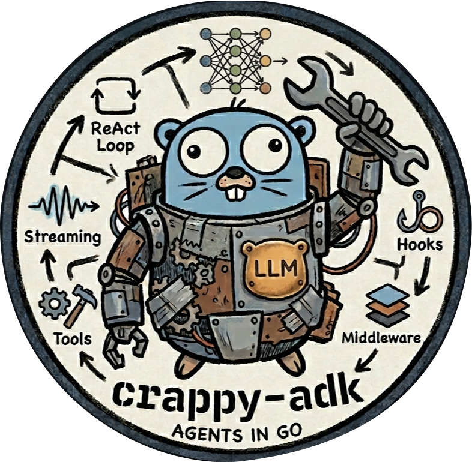

# Crappy Agent Development Kit

<div align="center">
  <br/><br/>

  [](https://golang.org)
  [](https://pkg.go.dev/github.com/vitaliiPsl/crappy-adk)
  [](LICENSE)
</div>

A small toolkit for building AI agents in Go. ReAct loop, history, models, tools, and extension options.

## Motivation

Felt bored while on vacation, so decided to learn more about AI agents and build one myself.

## Contents

- [Install](#install)
- [Quick start](#quick-start)
- [Agent](#agent)
- [History](#history)
- [Models](#models)
- [Tools](#tools)
- [Structured output](#structured-output)
- [Streaming](#streaming)
- [Hooks](#hooks)
- [Guards](#guards)
- [Testing](#testing)
- [Extending](#extending)
- [Examples](#examples)
- [License](#license)

## Install

```sh
go get github.com/vitaliiPsl/crappy-adk
```

Requires Go 1.26.2.

API documentation: https://pkg.go.dev/github.com/vitaliiPsl/crappy-adk

## Quick start

```go
ctx := context.Background()

model, err := openai.New("gpt-5.4-nano",
    providers.WithAPIKey(os.Getenv("OPENAI_API_KEY")),
)
if err != nil {
    log.Fatal(err)
}

type WeatherArgs struct {
    City string `json:"city" jsonschema:"City to get weather for"`
}

weather, err := tool.New(
    "get_weather",
    "Get the current weather for a city.",
    func(_ *kit.RunContext, args WeatherArgs) (string, error) {
        return fmt.Sprintf("%s: 21°C and clear", args.City), nil
    },
)
if err != nil {
    log.Fatal(err)
}

a, err := agent.New(model, history.New(),
    agent.WithInstructions("You are a helpful assistant. Use tools when useful."),
    agent.WithTools(weather),
)
if err != nil {
    log.Fatal(err)
}

resp, err := a.Run(ctx, kit.NewUserMessage(
    kit.NewTextContent("What's the weather in Vienna?"),
))
if err != nil {
    log.Fatal(err)
}

fmt.Println(resp.Output.Text)
fmt.Printf("messages produced: %d\n", len(resp.Messages))
fmt.Printf("tokens used: in=%d out=%d\n", resp.Usage.InputTokens, resp.Usage.OutputTokens)
```

## Agent

An agent is a model plus its instructions, tools, and options. `agent.New` takes the model, the [history](#history) the agent works on, and options:

```go
a, err := agent.New(model, history.New(),
    agent.WithInstructions("You are a helpful assistant."),
    agent.WithInstructionsSource("Style", "Answer in two sentences or fewer."),
)
```

`WithInstructions` sets the agent's behavior and role, which always renders first. `WithInstructionsSource` appends sections in registration order, each rendered as `# source` followed by its text.

`a.Context(ctx)` returns the `kit.AgentContext` the next request would be built from: instructions, history messages, and tools. `AgentContext.InstructionsText()` renders the text sent to the model.

## History

The conversation an agent works on is a `kit.History`. Before each model request the agent reads the history's messages, and it appends the input, every model message, and every tool result to it.

```go
type History interface {
    Messages(ctx context.Context) ([]Message, error)
    Append(ctx context.Context, messages ...Message) error
}
```

`x/history` provides an in-memory history that remembers messages across runs:

```go
a, err := agent.New(model, history.New(),
    agent.WithInstructions("You are a helpful assistant."),
)

resp, err := a.Run(ctx, kit.NewUserMessage(
    kit.NewTextContent("My name is Vitalii."),
))

resp, err = a.Run(ctx, kit.NewUserMessage(
    kit.NewTextContent("What is my name?"),
))
```

Implement `kit.History` yourself for anything else, for example a history backed by durable storage or one that compacts old messages. `Messages` must be safe to repeat: the agent reads it again whenever a hook asks to rebuild a request.

## Models

Each model adapter package exposes a `New(...)` constructor that returns a `kit.Model`. The agent doesn't know or care which backend is behind it — it always calls `Stream(...)` internally and assembles the final response.

| Model adapter | Package                    | API                              |
|----------|----------------------------|----------------------------------|
| Anthropic | `providers/anthropic`     | Anthropic Messages API           |
| OpenAI    | `providers/openai`        | OpenAI Responses API             |
| Google    | `providers/google`        | Gemini GenerateContent API       |

All three model adapters support extended thinking via `agent.WithThinking(...)` where the underlying model offers it.

These adapters represent API dialects rather than vendor names. Shared construction options live in `providers`.

`providers/openai` targets the OpenAI Responses API and can also point at OpenAI-compatible backends (Ollama, LM Studio, gateways):

```go
model, err := openai.New("gemma4",
    providers.WithBaseURL("http://localhost:11434/v1"),
)
```

`providers/anthropic` targets the Anthropic Messages API:

```go
model, err := anthropic.New("claude-compatible",
    providers.WithAPIKey(apiKey),
    providers.WithBaseURL("https://your-anthropic-compatible-gateway.example.com"),
)
```

`providers/google` targets the Gemini GenerateContent API:

```go
model, err := google.New("gemini-compatible",
    providers.WithAPIKey(apiKey),
    providers.WithBaseURL("https://your-gemini-compatible-gateway.example.com"),
)
```

## Tools

Tools are the actions the agent can take during the ReAct loop. Each tool has a name, a description the model uses to decide when to call it, a JSON schema for its arguments, and an execute function.

`Generic[I, O]` in `x/tool` wraps a typed Go function as a tool. The JSON schema for arguments is generated automatically from `I` — no manual schema definition needed. Arguments are validated against the schema before the handler is called. If `O` is a string the value is returned as-is; any other type is JSON-marshalled before being returned to the model.

```go
type GetTimeInput struct {
    Timezone string `json:"timezone" jsonschema:"IANA timezone name, e.g. America/New_York"`
}

getTime, err := tool.New(
    "get_time",
    "Get the current time in a given IANA timezone.",
    func(_ *kit.RunContext, args GetTimeInput) (string, error) {
        loc, err := time.LoadLocation(args.Timezone)
        if err != nil {
            return "", fmt.Errorf("unknown timezone: %s", args.Timezone)
        }
        return time.Now().In(loc).Format(time.RFC3339), nil
    },
)
```

Use `tool.MustNew(...)` for the panic-on-error variant in test code or top-level vars.

Anything implementing `kit.Tool` works — `Generic` is the convenience wrapper, not a requirement.

Pass tools to the agent with `agent.WithTools(...)`. Tool names must be unique; `agent.New` returns an error for duplicates.

```go
a, err := agent.New(model, history.New(),
    agent.WithInstructions("You are a helpful assistant. Use tools when useful."),
    agent.WithTools(getTime),
)
```

## Structured output

Use `agent.WithOutputSchema(...)` when the final model response must conform to a JSON schema. `output.For[T]` derives the schema from a Go type, and `output.Decode[T]` decodes the validated result.

```go
type Assessment struct {
    Status         string `json:"status" jsonschema:"One of healthy, degraded, or unavailable"`
    Summary        string `json:"summary" jsonschema:"Concise explanation of the assessment"`
    NeedsAttention bool   `json:"needs_attention" jsonschema:"Whether a person needs to investigate"`
}

schema, err := output.For[Assessment](
    "service_assessment",
    "The completed service health assessment",
)
if err != nil {
    log.Fatal(err)
}

a, err := agent.New(model, history.New(),
    agent.WithInstructions("Inspect the service, then return an assessment."),
    agent.WithTools(checkService),
    agent.WithOutputSchema(schema),
)

resp, err := a.Run(ctx, kit.NewUserMessage(
    kit.NewTextContent("Assess the checkout service."),
))
if errors.Is(err, kit.ErrInvalidOutput) {
    log.Fatal("model returned an invalid assessment")
}
if err != nil {
    log.Fatal(err)
}

assessment, err := output.Decode[Assessment](resp)
if err != nil {
    log.Fatal(err)
}
```

The schema constrains only the final response; the agent can still call tools during earlier turns. The JSON text remains in the final model message and the history, while `AgentResponse.StructuredOutput` contains the validated raw JSON.

Validation fails with `kit.ErrInvalidOutput` when the final response is empty, invalid JSON, or does not satisfy the schema. The invalid final message is not appended to the history. JSON Schema support differs between providers, so prefer simple object schemas with explicit fields. For nullable values, use required pointer fields rather than omitted properties when portability matters.

## Streaming

`Stream` returns a lazy single-consumption iterator that yields fine-grained events as they arrive. Range over it once with `stream.Iter()`, then call `stream.Result()` for the final response and any terminal error. If you call `stream.Result()` before iteration starts, it drains the stream for you. If you stop iterating early, `stream.Result()` returns the partial result accumulated so far and does not resume.

The stream emits content lifecycle events (`content_started`, `content_delta`, `content_done`) for every kind of content — text, thinking, tool calls, and tool results — plus a higher-level `message` event once each message is fully assembled.

```go
stream := a.Stream(ctx, kit.NewUserMessage(
    kit.NewTextContent("Tell me a story."),
))

for event := range stream.Iter() {
    switch event.Type {
    case kit.EventContentStarted:
        switch event.Content.Type {
        case kit.ContentTypeThinking:
            fmt.Println("[thinking]")
        case kit.ContentTypeText:
            fmt.Println("[response]")
        case kit.ContentTypeToolCall:
            fmt.Printf("[tool call] %s\n", event.Content.ToolCall.Name)
        }
    case kit.EventContentDelta:
        switch event.Content.Type {
        case kit.ContentTypeThinking:
            fmt.Print(event.Content.Thinking.Text)
        case kit.ContentTypeText:
            fmt.Print(event.Content.Text.Text)
        }
    case kit.EventContentDone:
        if event.ToolResult != nil {
            if event.ToolResult.Error != "" {
                fmt.Printf("[tool error] %s: %s\n", event.ToolResult.Call.Name, event.ToolResult.Error)
            } else {
                fmt.Printf("[tool result] %s\n", event.ToolResult.Call.Name)
            }
        }
    case kit.EventMessage:
        fmt.Printf("[message %s complete]\n", event.Message.Role)
    }
}

resp, err := stream.Result()
if err != nil {
    log.Fatal(err)
}

fmt.Printf("final text: %s\n", resp.Output.Text)
```

## Hooks

Hooks cover the stages of the ReAct loop. They receive `*kit.RunContext` and may inspect or mutate run state. Returning a modified value replaces the original; returning an error aborts the run. Tool hooks turn errors into tool results so the model can react to the failure. Model error hooks can recover through one bounded retry.

**`WithOnTurnStart`** — start of each turn, before the model is called.
```go
func(rc *kit.RunContext) error
```

**`WithOnTurnEnd`** — end of each turn, after any tool calls in that turn have executed.
```go
func(rc *kit.RunContext) error
```

**`WithOnModelRequestReady`** — after request construction. Return `true` after changing the history to read it again and rebuild the request before the next ready hook. Ready hooks run once in order; rebuilding repeats only the history read.
```go
func(rc *kit.RunContext, req kit.ModelRequest) (rebuild bool, err error)
```

**`WithOnModelResponse`** — after each model call. Returned response replaces the original.
```go
func(rc *kit.RunContext, resp kit.ModelResponse) (kit.ModelResponse, error)
```

**`WithOnModelError`** — when a model call fails. Change the history and return `nil` to rebuild and retry once. Ready hooks do not run again. Returning an error passes it to the next error hook; the last error stops the agent.
```go
func(rc *kit.RunContext, req kit.ModelRequest, err error) error
```

**`WithOnToolCall`** — before each tool execution. Return an error to block the call; the error becomes the tool result and is sent back to the model.
```go
func(rc *kit.RunContext, call kit.ToolCall) (kit.ToolCall, error)
```

**`WithOnToolResult`** — after each tool execution.
```go
func(rc *kit.RunContext, result kit.ToolResult) (kit.ToolResult, error)
```

`RunContext` carries run messages, cumulative and last-call usage, and the stream emitter.

## Guards

`x/guard` provides hook-based runtime policies for stopping runaway or unexpectedly expensive runs. Guards are regular `agent.Option` values, so compose them with the rest of your agent setup.

```go
a, err := agent.New(model, history.New(),
    agent.WithInstructions("You are a helpful assistant."),
    guard.WithMaxTurns(12),
    guard.WithMaxToolCalls(40),
    guard.WithInputTokenBudget(80_000),
    guard.WithOutputTokenBudget(8_000),
    guard.WithTotalTokenBudget(88_000),
    guard.WithRepeatedToolCallLimit(2, 4),
)
```

Available guards:

- `WithMaxTurns(n)` stops before the next model call once the run has produced `n` model turns.
- `WithMaxToolCalls(n)` limits total tool calls requested during a run.
- `WithInputTokenBudget(n)`, `WithOutputTokenBudget(n)`, and `WithTotalTokenBudget(n)` limit cumulative accepted usage.
- `WithRepeatedToolCallLimit(maxRepeats, window)` detects repeated identical tool calls by tool name plus arguments, ignoring provider call IDs. The window counts tool-calling model responses including the current one; `window <= 0` checks all prior tool-calling responses.

Guard failures are exported sentinel errors: `ErrMaxTurnsExceeded`, `ErrMaxToolCallsExceeded`, `ErrBudgetExceeded`, and `ErrToolLoopDetected`.

## Testing

`kittest` provides programmable test doubles for `kit.Model` and `kit.Tool` so you can drive the agent loop deterministically in unit tests.

```go
m := kittest.NewModel(t,
    kittest.ModelResult{
        Response: kit.ModelResponse{
            Message:      kit.NewModelMessage(kit.NewTextContent("hello")),
            FinishReason: kit.FinishReasonStop,
        },
    },
)

a, _ := agent.New(m, history.New())
resp, err := a.Run(ctx, kit.NewUserMessage(kit.NewTextContent("hi")))
```

The test double records every request it receives, fails the test if the agent makes more calls than scripted, and ships with assertion helpers for inspecting recorded calls.

## Extending

Everything is an interface. If something doesn't fit, replace it.

- **History** — `kit.History`. Use `history.New()` from `x/history` for an in-memory history, or implement your own.
- **Model** — `kit.Model`. Point at any inference backend via a model adapter package or implement your own.
- **Tool** — `kit.Tool`, or use `tool.New[I, O]` from `x/tool` for auto-schema from a Go struct.
- **Output schema** — `kit.OutputSchema`, or derive one from a Go type with `output.For[T]`.
- **Guard** — runtime policies from `x/guard`, such as turn, tool-call, token-budget, and repeated-tool-call limits.
- **Hooks** — typed function values registered with `WithOn...` options.
- **Extension** — `agent.WithExtensions(opts...)` bundles a set of options into a reusable capability.

## Examples

| Example                         | What it shows                                    |
|---------------------------------|--------------------------------------------------|
| `examples/01-basic`             | `Run()`, no tools                                |
| `examples/02-tools`             | `tool.MustNew` with a typed custom tool          |
| `examples/03-providers`         | Anthropic, Google, and OpenAI side by side       |
| `examples/04-local-model`       | `providers/openai` against a local Ollama server |
| `examples/05-multi-turn`        | Multi-turn conversation with in-memory history   |
| `examples/06-streaming`         | `Stream()`, thinking, text deltas, tool events   |
| `examples/07-structured-output` | Typed, validated final responses with tools      |

Run any example from the repo root:

```sh
OPENAI_API_KEY=... go run ./examples/01-basic
```

## License

MIT — see [LICENSE](LICENSE).
